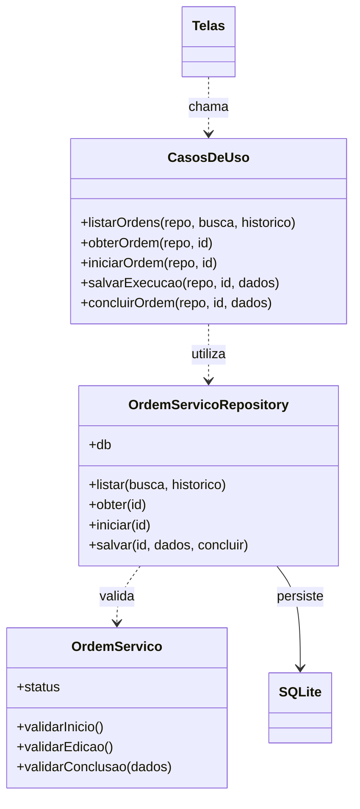
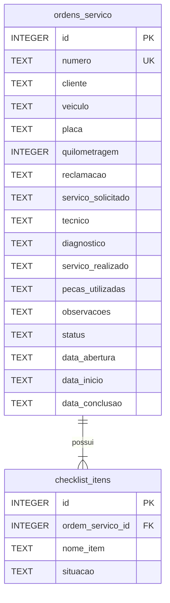

# Arquitetura e banco

O fluxo é Tela → caso de uso → repositório → SQLite. A entidade `OrdemServico` concentra as pré-condições de início, edição e conclusão. Os casos de uso são funções pequenas, sem injeção de dependência avançada: recebem o repositório. O repositório verifica o estado atual do banco dentro de uma transação antes de escrever. Não há entidades de Cliente ou Veículo porque o escopo só consulta os dados recebidos na OS fictícia.

`App.js` abre o banco uma vez e inicializa as tabelas. `presentation/navigation/AppNavigator.js` configura o native stack do React Navigation. A sessão é um estado React, sem tabela de usuários. As rotas de atendimento só existem após o login. Histórico e lista usam o mesmo componente com filtro. As telas chamam casos de uso e não executam SQL.

## Diagrama de classes

`CasosDeUso` representa o módulo de funções, não uma classe implementada. `Telas` agrupa os componentes React e `SQLite` representa a biblioteca.

## DER

Há exatamente duas tabelas de aplicação. A chave estrangeira é habilitada na conexão. A combinação ordem/item é única e os estados possuem restrições CHECK. Os seis itens são criados junto da OS na transação inicial. Início e conclusão podem ser nulos enquanto ainda não ocorreram. Textos de execução vazios permitem registros parciais. A busca usa parâmetros SQL, inclusive para textos com aspas. Gravações de OS e checklist são atômicas: uma falha causa rollback.

O banco `gama-tecnico.db` é criado no diretório padrão do Expo SQLite. Reinicialização não duplica exemplos. Não há migrações adicionais porque esta é a primeira versão do esquema. Fontes técnicas: [Expo SQLite](https://docs.expo.dev/versions/latest/sdk/sqlite/) e [React Navigation](https://reactnavigation.org/docs/getting-started/).
